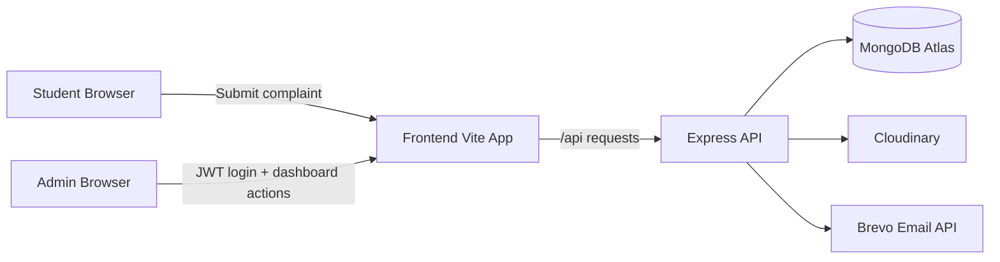

# AMU Complaint Portal

AMU Complaint Portal is a full-stack web application for collecting student complaints, uploading supporting evidence, notifying administrators by email, and managing complaint resolution through an authenticated admin dashboard.

## Table of Contents

1. Overview
2. Tech Stack
3. Repository Structure
4. Features
5. System Architecture
6. Prerequisites
7. Environment Variables
8. Local Development Setup
9. API Documentation
10. Admin Authentication and Authorization Flow
11. Complaint Lifecycle
12. Testing and Quality Checks
13. Production Deployment Guide
14. Security and Operations Checklist
15. Troubleshooting Guide
16. Handover Checklist

## 1) Overview

The platform consists of:

- A public frontend where students submit complaints.
- A backend API that validates and stores complaint records in MongoDB.
- Cloudinary integration for evidence file storage.
- Brevo integration for email notifications.
- A protected admin dashboard for complaint review and status updates.

## 2) Tech Stack

### Frontend

- React 19
- Vite 8
- React Router
- Framer Motion
- Tailwind CSS
- Vitest + Testing Library

### Backend

- Node.js 20+
- Express 5
- MongoDB + Mongoose
- JWT (jsonwebtoken)
- bcryptjs
- multer
- Cloudinary SDK
- Brevo API (email service)

## 3) Repository Structure

```text
AMU-repo/
	README.md
	backend/
		.env.example
		package.json
		src/
			app.js
			auth.js
			config.js
			db.js
			server.js
			middleware/
			models/
			routes/
			services/
	frontend/
		package.json
		vite.config.js
		src/
			App.jsx
			Admin/
			Components/
			Pages/
```

## 4) Features

### Public User Features

- Submit complaint with structured details.
- Upload up to 5 attachments (images/videos/documents with validation).
- Receive complaint reference number.
- Track complaint status by complaint number.

### Admin Features

- Admin registration (controlled by registration code).
- Admin login with JWT.
- Protected dashboard.
- Complaint listing and filtering.
- View complaint details and uploaded evidence.
- Update complaint status and add admin remarks.
- Dashboard statistics endpoint.

## 5) System Architecture



High-level flow:

1. Frontend sends complaint form to backend as multipart/form-data.
2. Backend validates input and uploads files to Cloudinary.
3. Backend stores complaint + attachment metadata in MongoDB.
4. Backend sends admin email notification through Brevo.
5. Admin logs in, receives JWT, and accesses protected dashboard APIs.

## 6) Prerequisites

- Node.js >= 20.19.0
- npm
- MongoDB Atlas cluster (or local MongoDB)
- Cloudinary account
- Brevo account with API key and verified sender

## 7) Environment Variables

Create `backend/.env` from `backend/.env.example`.

```dotenv
PORT=4000
CLIENT_URL=http://localhost:5173
MONGODB_URI=mongodb+srv://<DB_USER>:<URL_ENCODED_PASSWORD>@<CLUSTER_HOST>/amu-complaints?retryWrites=true&w=majority&appName=Cluster0
JWT_SECRET=replace-with-a-long-random-secret
ADMIN_REGISTRATION_CODE=replace-with-private-admin-code
CLOUDINARY_CLOUD_NAME=
CLOUDINARY_API_KEY=
CLOUDINARY_API_SECRET=
BREVO_API_KEY=
BREVO_SENDER_EMAIL=
BREVO_SENDER_NAME=AMU Complaint Portal
ADMIN_EMAIL=
```

Notes:

- `JWT_SECRET`: Use a long random secret in production.
- `ADMIN_REGISTRATION_CODE`: Used to control who can register admins.
- `CLIENT_URL`: Must match your frontend origin for CORS.
- `MONGODB_URI`: Must be reachable from backend runtime environment.

## 8) Local Development Setup

### Backend

```sh
cd backend
npm ci
cp .env.example .env
# Fill all required env values
npm run dev
```

### Frontend

```sh
cd frontend
npm ci
npm run dev
```

By default:

- Frontend: http://localhost:5173
- Backend API: http://localhost:4000
- Frontend proxies `/api` to backend.

## 9) API Documentation

Base path: `/api`

### Health

- `GET /health`
	- Response: `{ "status": "ok" }`

### Complaint APIs (Public)

- `POST /complaints`
	- Content-Type: `multipart/form-data`
	- Field `attachments`: up to 5 files
	- Validation includes email/mobile/category/date/file constraints
	- Response: `{ message, complaintNumber, notificationSent }`

- `GET /complaints/track/:complaintNumber`
	- Public status lookup
	- Response includes complaintNumber, status, adminRemarks, timestamps

### Admin Auth APIs

- `POST /admin/auth/register`
	- Body: `{ name, email, password, adminCode }`
	- Returns created admin profile (safe fields only)

- `POST /admin/auth/login`
	- Body: `{ email, password }`
	- Returns: `{ token, admin }`

- `GET /admin/auth/me`
	- Header: `Authorization: Bearer <token>`
	- Returns authenticated admin profile

### Admin Dashboard APIs (Protected)

All routes below require `Authorization: Bearer <token>`:

- `GET /admin/health`
- `GET /admin/complaints`
- `GET /admin/complaints/:id`
- `PATCH /admin/complaints/:id`
	- Body: `{ status, adminRemarks }`
- `GET /admin/stats`

## 10) Admin Authentication and Authorization Flow

1. Admin registers with secret admin registration code.
2. Admin logs in using email/password.
3. Backend verifies credentials and issues JWT.
4. Frontend stores token in localStorage.
5. Frontend includes token in `Authorization` header for protected requests.
6. Backend middleware validates token before serving admin routes.

## 11) Complaint Lifecycle

1. Student submits complaint.
2. Complaint stored with initial status `Pending`.
3. Admin reviews complaint and evidence.
4. Admin changes status to `In Progress` or `Resolved` and saves remarks.
5. Student can check status through tracking endpoint.

## 12) Testing and Quality Checks

### Frontend tests

```sh
cd frontend
npx vitest run
```

### Backend auth tests

```sh
cd backend
node --test src/auth.test.js
```

### Frontend production build

```sh
cd frontend
npm run build
```

## 13) Production Deployment Guide

### Recommended deployment split

- Frontend: static hosting (Vercel/Netlify/Cloudflare Pages/etc.)
- Backend: Node hosting (Render/Railway/EC2/Azure/etc.)
- Database: MongoDB Atlas

### Production essentials

1. Set all backend env vars in host dashboard.
2. Set `CLIENT_URL` to deployed frontend domain.
3. Add backend server IP/network access in MongoDB Atlas.
4. Use strong `JWT_SECRET`.
5. Use HTTPS in production.

### Atlas network access

- Development: whitelist your current machine IP.
- Production: whitelist backend server IP (or private networking/VPC options).
- Avoid permanent `0.0.0.0/0` unless strictly controlled and temporary.

## 14) Security and Operations Checklist

- Keep `.env` out of version control.
- Rotate secrets if exposed.
- Restrict admin registration in production.
- Monitor failed login attempts.
- Log key admin actions (status updates, remarks).
- Back up MongoDB data.
- Apply dependency updates periodically.

## 15) Troubleshooting Guide

### Backend cannot start / MongoDB connection error

Possible causes:

- `MONGODB_URI` is incorrect.
- Atlas IP/network access does not include backend runtime IP.
- DNS/network issue reaching Atlas.

Actions:

1. Verify URI from Atlas Connect panel.
2. Confirm Atlas Network Access includes your server IP.
3. Restart backend after env updates.

### `GET /api/admin/complaints` returns 401

Possible causes:

- Missing/expired JWT.
- Frontend token not stored or not sent.

Actions:

1. Re-login in admin page.
2. Check `Authorization` header format.

### Admin registration fails

Possible causes:

- Wrong `ADMIN_REGISTRATION_CODE`.
- Email already registered.
- Database unavailable.

## 16) Handover Checklist

Before delivering to client:

1. Configure production env vars.
2. Create initial admin account.
3. Confirm login, dashboard load, and status update flow.
4. Confirm complaint submission, file upload, and email notification.
5. Confirm complaint tracking endpoint works.
6. Restrict admin registration path as per client policy.
7. Share runbook for backups, secret rotation, and incident contacts.

---

For backend-specific details, see [backend/README.md](backend/README.md).
